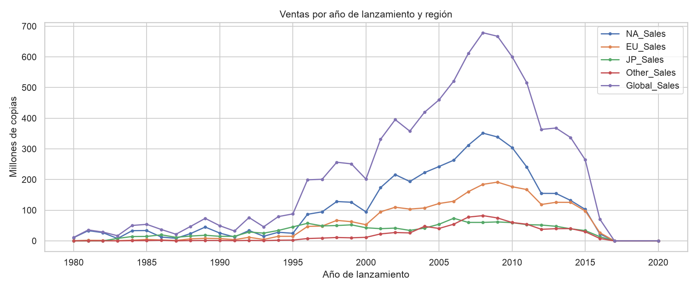

# Python Learning Journey 🐍

[](https://github.com/SantiagoGlez12/python-learning-journey/actions/workflows/python-checks.yml)

A collection of Python programming and data-analysis coursework, from basic functions to data manipulation, visualizations and exploratory analysis.

## Contents

| Module | Exercise | Status |
| --- | --- | --- |
| Fundamentals | [Power-of-two function](fundamentals/power_of_two.py) and [tests](tests/test_power_of_two.py) | Self-contained |
| M24 | [Population indicators](data-analysis/module-24-population-indicators.ipynb) | Original notebook; needs data-source validation |
| M25 | [lambda, map, reduce, filter](data-analysis/module-25-functional-tools.ipynb) | Original notebook |
| M26 | [Pandas country data](data-analysis/module-26-pandas-country-data.ipynb) | Original notebook; external CSV dependency |
| M27 | [Debugging and error handling](data-analysis/module-27-coursework.ipynb) | Original notebook; local paths may apply |
| M28 | [CSV, Excel and JSON file handling](data-analysis/module-28-file-formats.ipynb) | Original notebook; local input files required |
| M29 | [Web and API data](data-analysis/module-29-coursework.ipynb) | Original notebook; network access required |
| M30 | [Data manipulation with Pandas](data-analysis/module-30-coursework.ipynb) | Original notebook; input dataset required |
| M31 | [DataFrames, groupby and statistics](data-analysis/module-31-coursework.ipynb) | Original notebook; input dataset required |
| M32 | [FIFA dashboard wireframe and charts](data-analysis/module-32-coursework.ipynb) | Original notebook; input dataset required |
| M33 | [Video-game sales EDA](data-analysis/video-game-eda/README.md) | Original + portable notebooks, 11 charts and 11 CSV summaries; execution validation pending |

**Migration note:** Original notebook outputs were cleared to keep the Git history focused on source. Their source code is preserved, but not all notebooks have been retested in a clean environment. Some exercises contain local paths or downloads that must be adjusted before rerunning.

## Featured analysis: video-game sales

The [video-game EDA project](data-analysis/video-game-eda/README.md) includes a portable notebook, 11 saved figures and 11 derived tables from the coursework.



## Quick start

Use Python 3.10+:

```bash
python fundamentals/power_of_two.py
python -m unittest discover -s tests -v
```

For the notebooks, install Jupyter and check each notebook for its dependencies. Common data-science packages include `pandas`, `numpy`, `matplotlib`, `seaborn`, and `openpyxl`; some notebooks require additional packages or data files.

## Remaining improvements

- [ ] Verify external datasets and replace machine-specific paths with project-relative paths
- [ ] Add clear dependency instructions per notebook
- [ ] Migrate remaining earlier Python and visualization exercises
- [x] Integrate 11 original charts and 11 supporting CSV tables for M33
- [x] Add a project-relative M33 notebook copy
- [ ] Validate the M33 notebook end to end with the source dataset
- [ ] Execute a reproducibility pass and document verified results

## Related project

[Retail Data Integration & Analysis](https://github.com/SantiagoGlez12/retail-data-integration) presents a larger SQL and Pandas coursework project.
