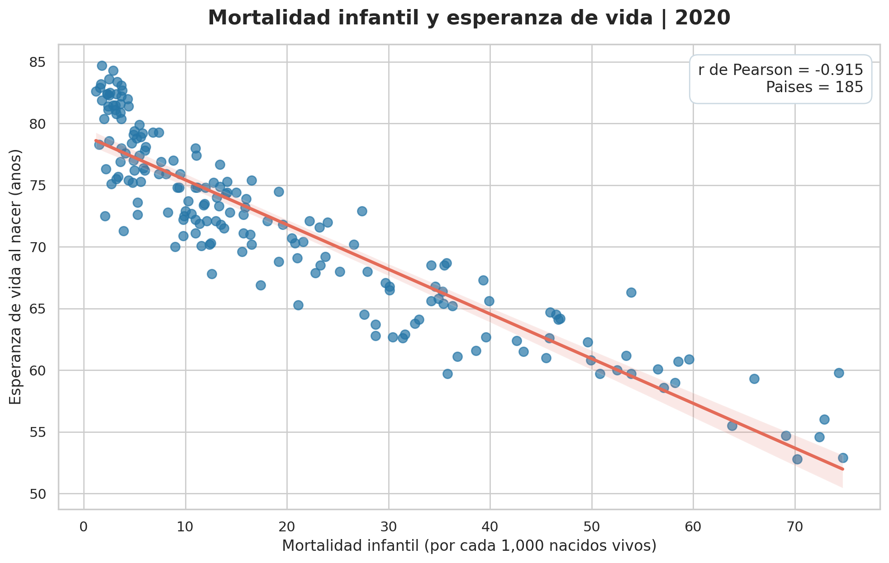
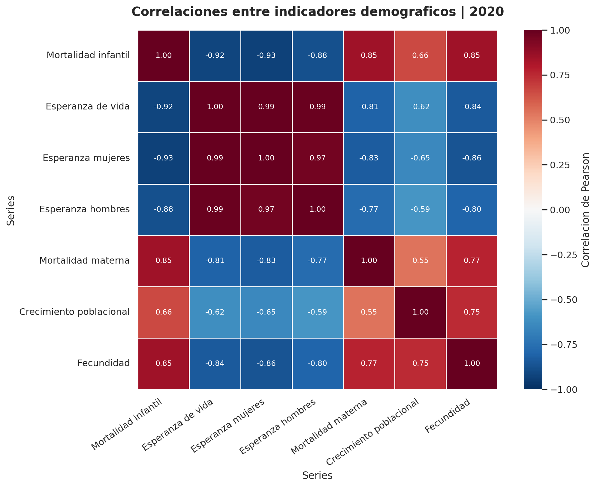
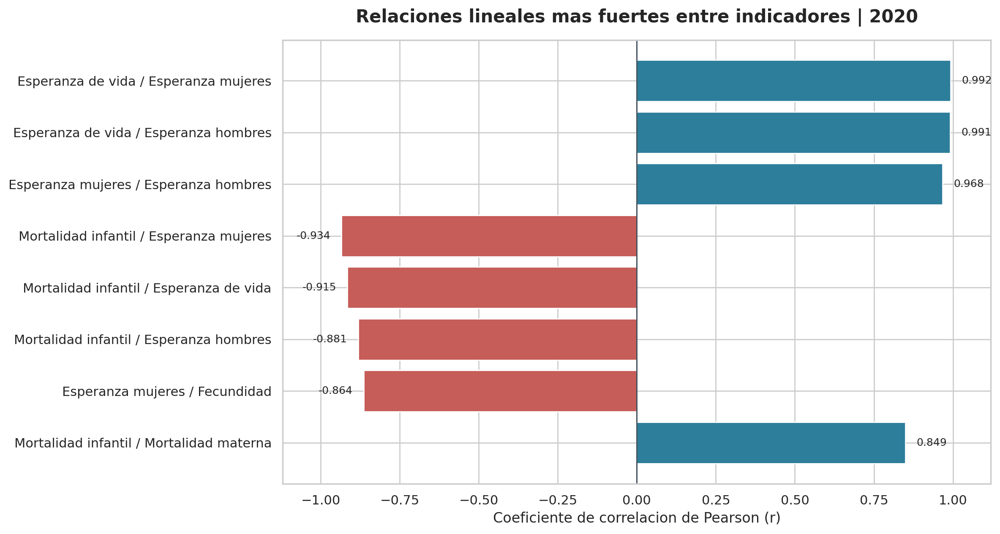

# Population indicators in 2020 — EBAC M24

An educational exploratory analysis of UN demographic indicators, focused on the relationship between infant mortality and life expectancy.

## Verified results

The original M24 analysis was **executed locally on 7 November 2026** using the original CSV downloaded from the course's Drive folder. The code produced all three PNG figures and both CSV outputs without fatal errors.

- **185** country rows with both infant-mortality and life-expectancy values.
- **7** indicators in the 2020 pivot table.
- Pearson correlation between infant mortality and life expectancy: **−0.915** (three-decimal rounding).

## Visualizations

The [correlation matrix](results/matriz_correlaciones_2020.csv) and [pair ranking](results/ranking_correlaciones_2020.csv) are included as CSV outputs. These five files are the original saved course deliverables; a separate local run also regenerated the same set of output filenames.

## Reproduce

Start Jupyter from the repository root and open the [portable notebook](../portable/module-24-population-indicators.ipynb). The script expects the original file `SYB66_246_202310_Population Growth, Fertility and Mortality Indicators.csv` in `data-analysis/datasets/population-2020/`. If absent, it attempts a `gdown` download from the course Drive file ID.

Install Python packages: `pandas`, `matplotlib`, `seaborn`, `jupyterlab` and `gdown`. The source CSV is not republished in this repository.

## Interpretation and limitations

Correlation is descriptive and does not establish causality. Regional aggregate codes are excluded using the explicit list in the notebook. Data completeness, definitions, and reporting periods vary by series and source. The separately executed local copy used the unchanged original logic with only the input location redirected; the portable notebook's external download and a fresh GitHub Actions run with the complete dataset have not been tested.

**Source:** UN Statistical Yearbook dataset provided in the EBAC coursework; original CSV in the owner's course Drive.
