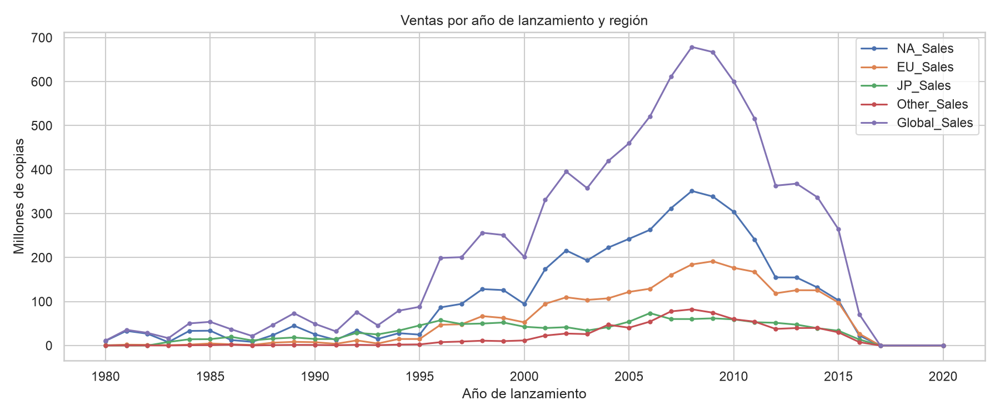
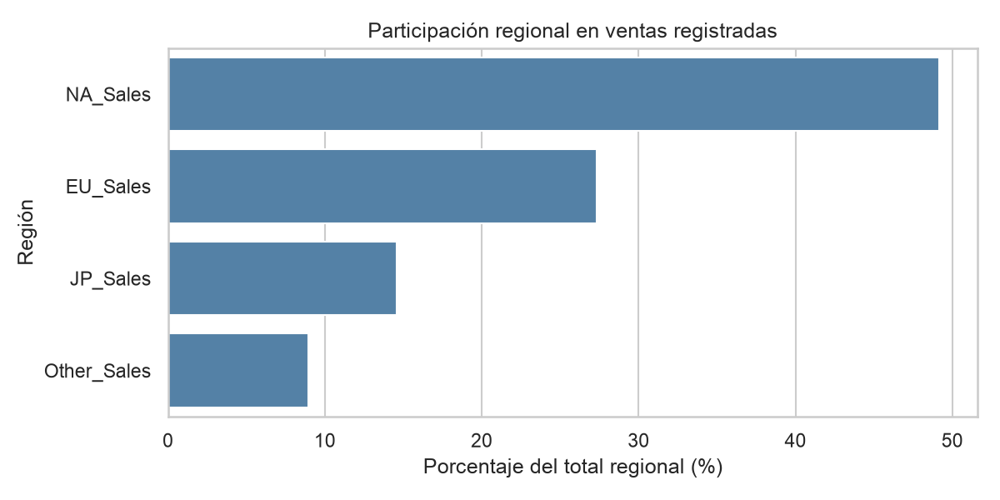
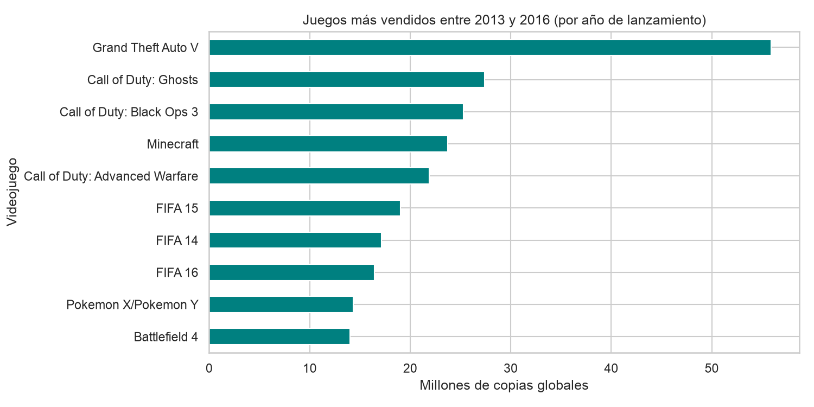
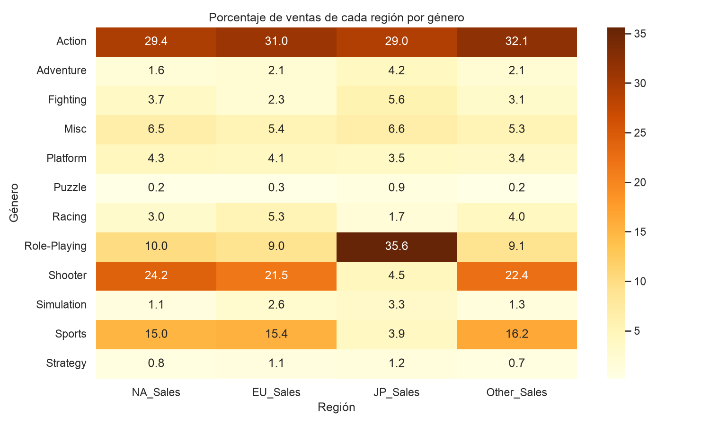

# Video-game Sales EDA (EBAC M33)

Exploratory data analysis of historical video-game sales by genre, year, region and platform, produced as an educational project. The source dataset comes from a publicly shared course link. The original notebook is preserved at [module-33-video-game-eda.ipynb](../module-33-video-game-eda.ipynb).

## Browse results

- [Portable notebook](portable_video_game_eda.ipynb): runs with project-relative paths rather than writing into the user's Downloads folder.
- [Eleven original figures](figures/): images produced for the original coursework presentation.
- [Eleven derived CSV summaries](derived-tables/): tabular outputs from the original analysis.

### Selected figures









## Reproduce the notebook

From the repository root:

```bash
python -m pip install -r data-analysis/video-game-eda/requirements.txt
jupyter notebook data-analysis/video-game-eda/portable_video_game_eda.ipynb
```

The portable notebook uses `data-analysis/video-game-eda/vgsales.csv`. If the file is missing, it attempts to download it using `gdown` from the public course source [vgsales.csv](https://drive.google.com/file/d/1YNDD-qJkSiz3EN4jGD9pOC-kEeBMURmf/view). The source CSV is **not** included here. You can manually place it at that path if the download fails.

Outputs generated by the portable notebook go into the ignored `generated/` directory. The committed figures and tables are the **original saved course results**; the analysis was rerun locally with the original source CSV, generating eleven figures and eleven derived CSV tables. The regenerated eleven CSV tables matched the saved coursework CSVs exactly. A fresh GitHub Actions run executing the complete notebook has not yet been verified. Refer to the original notebook for its assumptions and calculations.

## Interpretation caveats

- Sales figures follow the source dataset and should not be assumed to be current market performance.
- Launch year is not the same as year of sale.
- Some comparisons use a filtered subset of years. Treat percentage changes as descriptive rather than forecasts.
- The source dataset may have missing years and repeated game titles across platforms.

## Provenance

Original artifacts were migrated from the M33 coursework directory in the owner's Google Drive. Existing course outputs were preserved without inventing new results. Notebook execution outputs were cleared for readability.
